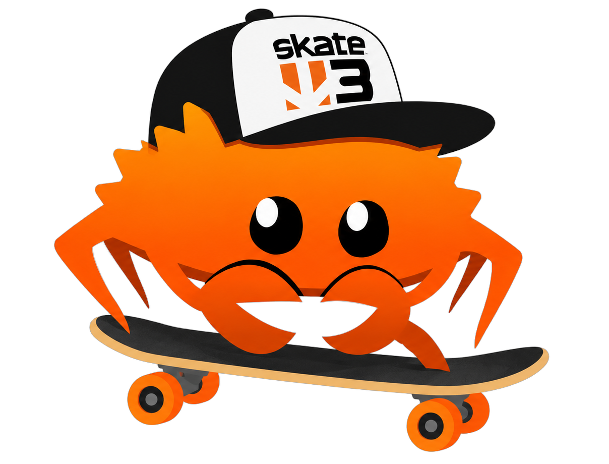

  

# Skate 3 AR for Meta Quest 3 (alpha)

The Skate 3 Rust engine running in passthrough AR on Quest 3: a skater in your
real room, riding your floor, tables and furniture, plus ramps, rails and
stairs you place with the Touch controllers. Grow or shrink the skater and
the park to any size. Clean (CC0) skate sounds.

**[Download the APK](https://github.com/andrewnakas/skate3-quest-ar/releases)** and
install it with `adb install -r`. Everything it needs is inside: the skater, animations and
sounds come from the [skate3-cleanroom](https://github.com/andrewnakas/skate3-cleanroom)
asset pack (regenerated model, textures and sounds), unpacked on first launch. No game files
to import. Sounds are spatial: they come from the skater, wherever it is in your room.
Controls are in [scripts/quest/README.md](scripts/quest/README.md).

**Handing off to Snap Spectacles?** Start with [docs/HANDOFF.md](docs/HANDOFF.md): how this
maps onto the C++ port [skatecore-cpp](https://github.com/andrewnakas/skatecore-cpp).

This is an early alpha built on the Skate 3 Rust Engine below.

# Skate 3 Rust Engine

A Rust and Bevy skating project built from Skate 3 reverse-engineering research.
Includes skating, tricks, grinds, offboard movement, difficulty settings and
`.skate` map support. Gameplay parity is still a work in progress.

## Mods and agent authoring

Drop mod ZIPs into top-level `mods/` and enable them in the Mods menu. **Point your coding agent at [sdk/AGENTS.md](sdk/AGENTS.md)**
to make a mod. See [package structure](docs/mod-packages.md), [Lua API](docs/lua-modding.md),
[vehicle API](docs/vehicle-sdk.md), [multiplayer mod SDK](docs/multiplayer-mods.md) and [Mixamo workflow](docs/mixamo-vehicle-workflow.md).
Editable examples live in `sdk/examples/`; `tools/package_mod.py` validates and packages them.
[Endless Tricks](docs/endless-tricks.md) is a bundled mod that extends the flip ladder past
retail's quad; run it with `PLAY-ENDLESS-TRICKS.bat`.

## Play

[Download Experimental](https://github.com/SK8-ENGINE/skate-3-rust-engine/releases/tag/experimental).
Successful `main` builds replace this prerelease. Choose **Latest** in Updates
for experimental updates; **Stable** is the default.

Extract the Windows release ZIP and run `skate3rust.exe`. Select your Skate 3
Xbox 360 ISO, or select `default.xex` in an extracted game folder. Keep its
`data` folder alongside it. Setup prepares the skater, animations and all disc maps, then
starts University. The original scoring and session-marker HUD assets are also
exported automatically during setup. No Blender, Python or Rust installation is needed.
ISO extraction needs internet access. The first conversion can take a while.

Use an XInput controller to play. Escape opens graphics, difficulty and map
settings. Maps can be switched without restarting the game.

**Skate 3 assets are not included.** Your converted files stay in
the `data` folder beside your executable. Each freshly unpacked copy runs its
own setup; it does not adopt another installation. In-place updates refresh
only changed asset groups.

## Build

Requires Windows, Rust with the MSVC toolchain, and LLVM installed in its default
location. Run `BUILD.bat` to build, then `PLAY.bat` to launch the test world.
`PLAY.bat` opens your saved map (University by default); use the in-game menu to switch maps, or drag a `.skate` file onto `PLAY.bat`. An XInput controller is required for gameplay;
Escape opens difficulty and graphics settings.

Development builds use a prepared asset set in `assets/private/` or the
installed asset directory. `scripts/Build-Release.ps1` builds the portable Windows
package and requires Python 3.13. GitHub Actions builds `main` automatically;
numbered releases are published separately.

Custom animations and climbing support remain available, but no custom clips
are shipped. The included format-demo map is original procedural content.

Implementation notes are in [`docs/`](docs/). Patched Bevy dependencies and
their licenses are in [`vendor/`](vendor/). This is an unofficial project,
not affiliated with EA.

## Advanced diagnostics

Windows builds support opt-in [performance timeline capture](docs/performance-tracing.md)
through the `--trace` CLI option, including optional GPU pass diagnostics.

## License

GPL-3.0, the same as the upstream
[Skate 3 Rust Engine](https://github.com/SK8-ENGINE/skate-3-rust-engine).
Clean skate sounds are CC0 (credits in `crates/skate-game/clean-audio/CREDITS.json`).
